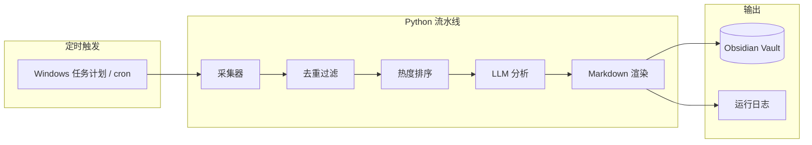

# AI 圈新闻总结分析助手 — 产品构想与实施计划

> 文档版本：v0.2  
> 更新日期：2026-05-19  
> 状态：**决策已锁定** → 待 Claude Code / Phase 1 实现

---

## 零、已锁定决策（2026-05-19）

| # | 项 | 决定 |
|---|-----|------|
| 1 | **Vault 路径** | `D:/Obsidian/Obsidian Vault` |
| 2 | **语言比例** | **英文标题** + **英文专业术语保留** + **分析全文中文**；重要原始来源可附英文摘录/链接 |
| 3 | **模型与开发方式** | 运行时 LLM 走 API（`config.yaml` 可配）；**本阶段用 Terminal 调用 Claude Code**，以 `idea.md` 为规格继续深化实现 |
| 4 | **深度 / 广度** | **深度固定 5 条**；**广度宜多**（速览清单可 20–40 条，弱信号 3–5 条） |
| 5 | **通知** | **仅 Obsidian 静默落盘**；不做邮件/Telegram。**远期**：自动发帖（见 Phase 5），当前范围外 |

### 输出语言规范（写入 prompt）

- **标题**：保留英文原标题（必要时括号内 6 字以内中文释义）
- **术语**：RAG、RLHF、MoE、context window、fine-tuning 等不强行翻译；首次出现可加简短中文括注
- **分析正文**：简体中文，口语化专业度，避免翻译腔
- **来源块**：链接 + 可选 1–2 句英文原文金句（仅当有出处时）

---

## 一、你要解决的核心问题

| 痛点 | 现状 | 目标状态 |
|------|------|----------|
| 信息过载 | Twitter/X、HN、Reddit、公众号、论文速递分散，刷不完 | 每天一份**可读完**的精选 digest |
| 只有资讯没有判断 | 收藏链接 ≠ 理解趋势 | 附带**因果链、争议点、二阶影响**的分析 |
| 缺乏个人立场沉淀 | 看完就忘，无法对比自己上周的判断 | Obsidian 里形成**可检索的时间线 + 预判记录** |
| 被动追热点 | 总是事后才知道大新闻 | 建立**弱信号 → 强信号**的追踪机制，练预判肌肉 |

**一句话定位**：不是「AI 新闻聚合器」，而是**帮你建立 AI 行业认知模型、并持续校准预判的每日思考伙伴**。

---

## 二、产品原则（做取舍时用）

1. **深 5 广多**：**5 条**走完整五段式深度；其余进「速览清单」（宜 20–40 条），弱信号单独列出。
2. **分析 > 摘要**：每条必须回答「所以呢？」——对开发者 / 产品 / 资本 / 监管哪一类人有影响。
3. **可证伪的预判**：鼓励记录「我认为 X 会在 Y 时间内发生」，日后回溯准确率。
4. **Obsidian 原生**：输出 Markdown + YAML frontmatter + wikilinks，不绑死专有格式。
5. **可审计**：每条结论附**来源链接 + 抓取时间**，避免幻觉当事实。
6. **成本可控**：默认用性价比模型做摘要，重要条目可升级强模型。

---

## 三、目标用户与使用场景（你就是用户）

- **角色**：关注 AI 的技术人 / 产品人 / 投资者视角的爱好者
- **每日 ritual**（约 15–20 分钟）：
  1. 早晨打开 Obsidian「今日 digest」
  2. 扫热点 + 读「我的判断待验证」区块
  3. 在 1–2 条上写几句自己的反驳或补充（双向链接到主题 MOC）
- **每周 ritual**（约 30 分钟）：周日自动生成「本周趋势 + 预判命中率」复盘

---

## 四、信息架构：Obsidian 库结构建议

```
AI_news/                          # 本仓库，或 symlink 进 vault
├── Daily/
│   └── 2026-05-19.md             # 每日自动报告（主交付物）
├── Weekly/
│   └── 2026-W20.md               # 周报复盘
├── Topics/                       # 主题 MOC（人工维护种子列表）
│   ├── LLM-训练与推理.md
│   ├── Agent-与工具链.md
│   ├── 开源生态.md
│   └── 监管与地缘.md
├── Predictions/
│   └── pred-2026-05-19-xxx.md    # 单条可证伪预判（从日报抽取）
├── Sources/                      # 源配置与 health 日志
│   └── sources.yaml
└── Templates/
    ├── daily-digest.md
    └── weekly-review.md
```

**日报 frontmatter 示例**：

```yaml
---
date: 2026-05-19
type: daily-digest
tags: [ai-news, auto]
sources_count: 42
items_deep: 5
items_brief: 30
model: configurable-via-config.yaml
run_id: abc123
---
```

---

## 五、内容模型：日报里应该有什么

### 5.1 固定版块（推荐顺序）

1. **今日一句话** — 今天 AI 圈最重要的变化是什么（≤50 字）
2. **🔥 热点深度（固定 5 条）** — 标题英文，分析中文  
   - 发生了什么（事实，附链接）  
   - 为什么重要（行业语境）  
   - 各方观点 / 争议  
   - **二阶影响**（对开源、算力、应用层、监管…）  
   - **置信度**（高/中/低）+ 信息缺口
3. **📡 弱信号雷达（2–3 条）** — 讨论量还不高但值得盯的（论文、repo star 激增、招聘 JD 变化等）
4. **🧭 趋势连线** — 与过去 7/30 天主题的关联（wikilink 到 `Topics/`）
5. **🔮 预判草稿（1–2 条）** — 可证伪陈述 + 验证时间点 → 自动写入 `Predictions/`
6. **📎 速览清单（宜 20–40 条）** — 英文标题一行 + 来源链接，不展开分析
7. **✍️ 留给你** — 空白「我的看法 / 要验证」提示区（模板固定，方便你 habit）

### 5.2 分析框架（写入 system prompt，保证风格一致）

对每条深度新闻，强制走 **FACT → CONTEXT → STAKEHOLDERS → IMPLICATIONS → UNCERTAINTY** 五段，避免变成 Wikipedia 摘要。

### 5.3 周报复盘额外输出

- 本周主题聚类（embedding 或关键词共现）
- 上周预判逐条对照：✅ / ❌ / ⏳ 待定
- 「我漏掉了什么」— 对比 HN 热榜与 digest 的 diff（可选）

---

## 六、信息源策略（分层，可配置）

### Tier 0 — 必抓（MVP）

| 类型 | 源 | 获取方式 |
|------|-----|----------|
| 聚合 | Hacker News（AI 相关） | Algolia HN API / RSS |
| 聚合 | Reddit r/MachineLearning, r/LocalLLaMA | JSON API / RSS |
| 官方 | OpenAI / Anthropic / Google AI / Meta AI blog | RSS |
| 代码 | GitHub Trending（AI tags） | API / 第三方 |
| 中文 | 机器之心、量子位等（选 1–2 个） | RSS（注意 ToS） |

### Tier 1 — 增强

- Twitter/X 列表（需 API 或 Nitter 替代，成本高）
- arXiv cs.CL / cs.LG 每日新稿（标题+摘要）
- Newsletter：The Batch、Import AI 等
- 播客 show notes（低频）

### Tier 2 — 付费/难

- 私域社群、Discord（一般不自动化，手动 pin）

**去重规则**：URL 归一化 + 标题相似度 + 24h 内同源只保留最早/最权威一篇。

---

## 七、技术架构（推荐路径）



### 7.1 技术栈建议

| 层级 | 选型 | 理由 |
|------|------|------|
| 语言 | **Python 3.11+** | 生态成熟，适合脚本+定时任务 |
| 依赖管理 | `uv` 或 `poetry` | 快、锁版本 |
| 采集 | `httpx` + `feedparser` + 各源 adapter | 插件化 `sources/*.py` |
| 缓存 | SQLite（`data/news.db`） | 去重、历史检索、周报聚合 |
| LLM | OpenAI / Anthropic / 本地 Ollama 可切换 | `config.yaml` 里配 provider |
| 模板 | Jinja2 | 控制 Obsidian 输出格式 |
| 通知 | **无**（静默写 vault） | 打开 Obsidian 即见；远期发帖见 Phase 5 |

### 7.2 目录结构（代码仓库）

```
AI_news/
├── idea.md                 # 本文档
├── README.md
├── pyproject.toml
├── config.yaml             # API keys 路径、vault 路径、时区、模型
├── config.example.yaml
├── src/
│   ├── main.py             # CLI: run daily | weekly | test-source
│   ├── fetchers/           # 每个源一个模块
│   ├── pipeline/
│   │   ├── dedup.py
│   │   ├── rank.py
│   │   ├── analyze.py      # LLM 调用 + prompt
│   │   └── render.py
│   └── obsidian/
│       └── writer.py       # 写 vault + 更新 MOC
├── prompts/
│   ├── daily_analyst.md
│   └── weekly_review.md
├── templates/
│   └── daily-digest.md.j2
├── data/                   # gitignore
└── tests/
```

### 7.3 Obsidian 写入方式（三选一）

| 方案 | 做法 | 优点 | 缺点 |
|------|------|------|------|
| **A. 直接写 Vault 路径** | `config.vault_path` 指向 Obsidian 库 | 简单、即开即看 | 路径要对，注意同步冲突 |
| **B. 写本仓库 + Obsidian Git 插件** | 报告 commit 后同步到手机 | 有版本历史 | 非实时 |
| **C. Obsidian URI** | `obsidian://new?...` 打开新笔记 | 交互感强 | 不适合无人值守批量 |

**MVP 推荐方案 A**：定时任务写完 `Daily/YYYY-MM-DD.md`，你打开 Obsidian 即见。

### 7.4 定时执行（Windows）

- **任务计划程序**：每天 07:00（或你起床前）运行  
  `uv run python -m src.main daily`
- 失败重试 1 次；写 `Sources/run-log.md` 记录耗时与错误
- 环境变量放 API Key（`.env`，不进 git）

---

## 八、LLM 与成本（粗算）

假设每日：~50–80 条候选 → 深度 5 条 + 速览 20–40 条 → 分析正文约 2500–3500 中文字。

| 模型档 | 用途 | 粗估成本/月 |
|--------|------|-------------|
| 便宜档 | 摘要、分类、去重、速览一行描述 | $3–10 |
| 标准档 | 深度分析 5 条（中文） | $10–25 |
| 混合 | 便宜筛 breadth + 贵模型只写 5 条 deep | **推荐** $8–20 |

**降本**：先本地 embedding 做聚类，每个簇只送 1 条代表给强模型。

---

## 九、分阶段实施计划

### Phase 0 — 决策周 ✅ 已完成

- [x] Vault 路径：`D:/Obsidian/Obsidian Vault`
- [x] 语言 / 深度 / 通知策略（见「零、已锁定决策」）
- [ ] 运行时 LLM provider + API Key（实现阶段在 `config.yaml` / `.env` 填写）
- [ ] 勾选 Tier 0 源清单（中文源、Reddit 实现时最终确认）
- [ ] 定每日运行时间与时区（默认 `Asia/Shanghai` 07:00，可改）

### Phase 1 — MVP（3–5 天）

**交付**：一条命令产出可读日报，手动运行。

- [ ] 项目脚手架 + `config.example.yaml`
- [ ] 实现 3 个 fetcher（HN + 1 blog RSS + GitHub trending）
- [ ] SQLite 去重 + 简单热度排序（分 + 评论数）
- [ ] 单 prompt 产出 `Daily/日期.md`（含 frontmatter）
- [ ] 日志与失败不静默

**验收标准**：连续 3 天手动跑，你每天能在 15 分钟内读完并愿意在「留给你」区写两句。

### Phase 2 — 分析质量（3–5 天）

- [ ] 五段式分析 prompt + 弱信号版块
- [ ] Topics MOC 自动 wikilink（关键词 → 预定义映射表）
- [ ] `Predictions/` 自动拆文件
- [ ] ~~通知~~（已明确：不做，仅静默落盘）

### Phase 3 — 自动化与周报（2–3 天）

- [ ] Windows 任务计划 / 文档化 setup
- [ ] 周报：预判回溯 + 主题聚类
- [ ] 源健康检查（某 RSS 挂了发警告）

### Phase 4 — 迭代（持续）

- [ ] 加源、调 ranking 权重
- [ ] 你的反馈按钮：在笔记里标 `#noise` / `#gold`，反向调权重（高级）
- [ ] 可选 Web UI 预览（非必须）

### Phase 5 — 远期：自动发帖（当前不做）

- [ ] 从 `Daily/` 选取片段 → X / 公众号 / 论坛等（需单独合规与 API 设计）
- [ ] 与 Obsidian 落盘解耦：先保证 digest 质量，再考虑分发

---

## 十、关键配置项（`config.yaml` 草案）

```yaml
vault:
  path: "D:/Obsidian/Obsidian Vault"
  daily_dir: "AI_news/Daily"
  predictions_dir: "AI_news/Predictions"
  weekly_dir: "AI_news/Weekly"

schedule:
  timezone: "Asia/Shanghai"
  daily_hour: 7

llm:
  provider: "anthropic"           # openai | anthropic | ollama — 实现时填写
  model_fast: "claude-haiku-..."  # 广度筛选、速览
  model_deep: "claude-sonnet-..." # 5 条深度分析
  max_items_deep: 5
  max_items_brief: 35

sources:
  hackernews: { enabled: true, min_score: 100 }
  reddit: { enabled: true, subreddits: ["MachineLearning", "LocalLLaMA"] }
  rss:
    - name: openai-blog
      url: https://openai.com/blog/rss.xml
  github_trending: { enabled: true, since: daily }

ranking:
  weights:
    score: 0.4
    comments: 0.3
    recency_hours: 0.3

output:
  title_language: en            # 标题保持英文
  analysis_language: zh-CN      # 分析全文中文
  keep_terms_in_english: true   # RAG, MoE, RLHF 等不翻译
  include_source_excerpt: true  # 重要源可附英文原文短引
  include_raw_links: true

notify:
  enabled: false                # 静默落盘；Phase 5 再考虑发帖/推送
```

---

## 十点五、开发工作流：用 Claude Code 继续实现

规格以本文件为准；代码仓库路径：

`e:\22_AI\02_vibe coding\AI_news`

### 推荐启动方式

```powershell
cd "e:\22_AI\02_vibe coding\AI_news"
claude
```

进入 Claude Code 后，可直接粘贴：

```text
请阅读 idea.md（尤其「零、已锁定决策」和 Phase 1），在本仓库实现 MVP：
- Python 3.11+，uv 管理依赖
- config.example.yaml + .env.example（vault 已定为 D:/Obsidian/Obsidian Vault）
- fetcher: HN + 一个官方 blog RSS + GitHub trending
- SQLite 去重，输出到 vault 的 AI_news/Daily/YYYY-MM-DD.md
- 日报格式：5 条英文标题+中文深度分析，20–35 条英文标题速览
- 无通知；失败写日志
完成后给出运行命令与首次测试步骤。
```

### 分工建议

| 角色 | 负责 |
|------|------|
| **idea.md** | 产品规格、输出格式、决策记录（你与我维护） |
| **Claude Code** | 脚手架、fetcher、pipeline、prompt、本地跑通 |
| **你** | API Key、任务计划、读 digest 后反馈调参 |

运行时 LLM **不必**与 Claude Code 相同；Code 只写代码，日报生成用 `config.yaml` 里的 API。

---

## 十一、风险与对策

| 风险 | 对策 |
|------|------|
| LLM 幻觉编造新闻 | 强制「无来源不写」；原文只许来自 fetch 结果 |
| RSS/API 失效 | 源健康日志；多源冗余 |
| 中文源版权 | 只抓标题+链接+一句摘要，不全文转载 |
| Obsidian 同步冲突 | 固定单机写入时间；或用 Git 单向同步 |
| 越看越焦虑 | 每周设「不读日」；digest 字数上限 |
| 预判变成算命 | 模板要求写清「依据」和「证伪条件」 |

---

## 十二、决策记录（已全部确认）

见文首 **「零、已锁定决策」**；无需再答问卷。

---

## 十三、下一步行动

1. **Terminal 启动 Claude Code**（见 **10.5 节**），按 Phase 1 实现 MVP。
2. 在 `D:/Obsidian/Obsidian Vault` 下首次运行后应自动生成 `AI_news/Daily/`（或由脚本创建）。
3. 准备 `.env`：`ANTHROPIC_API_KEY` 或你选用的 provider（与 Claude Code 账号无关）。
4. MVP 跑通 3 天后，再挂 Windows 任务计划（Phase 3）。

---

## 附录 A — 示例日报片段（目标质感）

```markdown
## 🔥 OpenAI cuts API prices on reasoning models (batch tier)

**事实**：…（[HN discussion](url) | [Official blog](url) | fetched 2026-05-19 06:12 UTC）  
> Source excerpt: *"We're reducing input token prices by…"*（英文原文一句，可选）

**语境**（中文）：这是继 3 月 YYY 之后，在 inference 定价上的第二次下调…

**争议**：支持者认为…；批评者指出…

**二阶影响**：
- 应用层：小团队 RAG 成本下降 → Agent 创业门槛降低
- 开源：对 Llama 系推理服务定价形成压力

**置信度**：高（有官方博文）；待核实：ZZZ 数据尚未公布

**预判草稿**：若定价维持 6 个月，本地 7B 部署热度会下降 → 见 [[pred-2026-05-19-local-deploy]]
```

---

## 附录 B — 与「普通新闻机器人」的差异

| 维度 | 普通聚合 | 本产品目标 |
|------|----------|------------|
| 输出 | 标题列表 | 因果 + 争议 + 影响 |
| 记忆 | 无 | Obsidian 时间线 + 预判库 |
| 优化指标 | 点击量 | 你 30 天后的判断准确率 |
| 成功标准 | 信息更多 | **思考更少但更准** |

---

*本文档随项目演进更新；实现细节以 `README.md` 与代码为准。*
